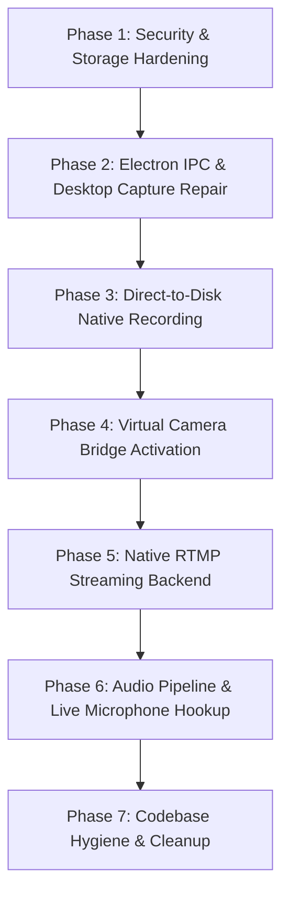

# Nexus Broadcast Suite — Comprehensive Engineering Audit Report

**Date:** October 12, 2026  
**Auditor:** Senior Electron Architect & Broadcast Systems Engineering Team  
**Scope:** Full-stack codebase inspection, non-destructive verification, media pipelines, IPC, state architecture, security, and external output integrations  
**Target Project:** `c:\broadcast-suite3\desktop-app`  

---

## Executive Summary

A comprehensive, non-destructive engineering audit was performed across the entire **Nexus Broadcast Suite** codebase. The inspection covered the Electron main process, IPC layer, React 19 renderer, Canvas 2D render pipeline, Web Audio graph, persistence layer, recording/streaming pipelines, and external integrations (Virtual Camera, NDI, SRT).

### Baseline Check Results
- **TypeScript Typecheck (`tsc -b`):** **0 errors** (Passed)
- **Automated Regression Suite (`node --test tests/*.test.cjs`):** **12 / 12 test suites passed (100%)**
- **Production Build (`vite build`):** **Passed** in 9.39s (Clean bundle output in `dist/`)
- **Static Reachability Analysis (`node scripts/audit.cjs`):**
  - Total source files in `src/`: **105 files**
  - Active reachable modules: **38 files**
  - Unreachable/orphaned candidates: **67 files**
  - Circular import cycles: **0 active cycles**
  - Missing IPC handlers in Main process: **8 channels**

---

## 1. Confirmed Findings and Supporting File Paths

### 1.1 Electron Main Process & Security Architecture
- **Insecure Renderer Configuration:**
  - File: [`electron/main.js`](file:///c:/broadcast-suite3/desktop-app/electron/main.js#L18-L23)
  - `BrowserWindow` is instantiated with `nodeIntegration: true`, `contextIsolation: false`, and `webSecurity: true`, with **no preload script**.
  - The renderer process executes with direct Node.js privileges (`child_process`, `fs`, `process`). Any third-party asset, SVG, remote web frame, or script injection has unconfined host access.
- **IPC Handler Disconnects:**
  - File: [`electron/main.js`](file:///c:/broadcast-suite3/desktop-app/electron/main.js#L33-L104)
  - The Main process only registers 5 IPC handlers: `broadcast-capabilities`, `get-sources`, `window-close`, `window-maximize`, `window-minimize`.
  - The Renderer process actively invokes or sends on 8 unregistered channels:
    - `start-stream-single` ([`NewBroadcastContext.tsx:1597`](file:///c:/broadcast-suite3/desktop-app/src/context/NewBroadcastContext.tsx#L1597))
    - `stop-stream-single` ([`NewBroadcastContext.tsx:1620`](file:///c:/broadcast-suite3/desktop-app/src/context/NewBroadcastContext.tsx#L1620))
    - `stream-chunk-single` ([`NewBroadcastContext.tsx:1613`](file:///c:/broadcast-suite3/desktop-app/src/context/NewBroadcastContext.tsx#L1613))
    - `start-virtual-camera` ([`NewBroadcastContext.tsx:1710`](file:///c:/broadcast-suite3/desktop-app/src/context/NewBroadcastContext.tsx#L1710))
    - `stop-virtual-camera` ([`NewBroadcastContext.tsx:1730`](file:///c:/broadcast-suite3/desktop-app/src/context/NewBroadcastContext.tsx#L1730))
    - `vcam-chunk` ([`NewBroadcastContext.tsx:1725`](file:///c:/broadcast-suite3/desktop-app/src/context/NewBroadcastContext.tsx#L1725))
    - `set-next-screen-id` ([`NewBroadcastContext.tsx:1506`](file:///c:/broadcast-suite3/desktop-app/src/context/NewBroadcastContext.tsx#L1506))
    - `get-desktop-stream` ([`NewBroadcastContext.tsx:1512`](file:///c:/broadcast-suite3/desktop-app/src/context/NewBroadcastContext.tsx#L1512))

### 1.2 Preview and Program Scene Composition
- **Verification Result: FULLY FUNCTIONAL (Canvas 2D Engine)**
  - Files:
    - [`src/engine/RenderScheduler.ts`](file:///c:/broadcast-suite3/desktop-app/src/engine/RenderScheduler.ts)
    - [`src/engine/CanvasRenderer.ts`](file:///c:/broadcast-suite3/desktop-app/src/engine/CanvasRenderer.ts)
    - [`src/engine/SceneRenderer.ts`](file:///c:/broadcast-suite3/desktop-app/src/engine/SceneRenderer.ts)
    - [`src/engine/SourceRenderer.ts`](file:///c:/broadcast-suite3/desktop-app/src/engine/SourceRenderer.ts)
    - [`src/components/PreviewMonitor.tsx`](file:///c:/broadcast-suite3/desktop-app/src/components/PreviewMonitor.tsx)
    - [`src/components/ProgramMonitor.tsx`](file:///c:/broadcast-suite3/desktop-app/src/components/ProgramMonitor.tsx)
  - The render loop runs at 60 FPS driving native `<canvas>` elements (`1920x1080`).
  - `SceneRenderer.renderScene()` correctly iterates scene sources, applying transforms (position, scale, rotation), filters (brightness, contrast, blur, chroma key, lut), opacity, and blend modes.
  - Live broadcast overlays (`CG 1`), video posters, news banners, and vector lower-thirds render with dynamic text and animations.
- **Architectural Duplication:**
  - File: [`src/components/SceneRenderer.tsx`](file:///c:/broadcast-suite3/desktop-app/src/components/SceneRenderer.tsx) is a legacy DOM-based `<div>` renderer that is completely unmounted in the active UI.

### 1.3 Transition Engine (T-Bar, Auto, Cut, Transitions)
- **Verification Result: FULLY FUNCTIONAL**
  - Files:
    - [`src/engine/CanvasRenderer.ts:80-190`](file:///c:/broadcast-suite3/desktop-app/src/engine/CanvasRenderer.ts#L80-L190)
    - [`src/components/TransitionTBar.tsx`](file:///c:/broadcast-suite3/desktop-app/src/components/TransitionTBar.tsx)
    - [`src/components/TransitionControlsExtended.tsx`](file:///c:/broadcast-suite3/desktop-app/src/components/TransitionControlsExtended.tsx)
    - [`tests/broadcast.test.cjs:61-95, 209-227`](file:///c:/broadcast-suite3/desktop-app/tests/broadcast.test.cjs#L61-L95)
  - Mathematical compositing is performed in `CanvasRenderer` using dual offscreen buffers (`transitionCanvas`, `incomingCanvas`).
  - Active transition modes: `mix` (cross-dissolve), `dip` (dips to black at 50%), `wipe`, `slide`, `push`, `zoom`, `cube`, `barnDoor`, and instantaneous `cut`.
  - Manual T-Bar dragging drives `setManualTransitionProgress()` in real-time, allowing bidirectional scraping between Preview and Program.

### 1.4 Audio Pipeline & Mixer
- **Verification Result: PARTIALLY IMPLEMENTED (Web Audio Graph Functional; Input Hookups Incomplete; Meter Synthesis)**
  - Files:
    - [`src/context/NewBroadcastContext.tsx:290-340`](file:///c:/broadcast-suite3/desktop-app/src/context/NewBroadcastContext.tsx#L290-L340)
    - [`src/components/AudioMixer.tsx`](file:///c:/broadcast-suite3/desktop-app/src/components/AudioMixer.tsx)
  - Real Web Audio API graph is initialized with master gain, compressor, brickwall limiter, delay node, 3-band shelf/peaking EQ, and stereo panner.
  - Video elements (`<video>`) are connected via `ctx.createMediaElementSource(el)`.
  - **Limitation 1:** Microphone and live audio inputs (`src.type === 'audio'`) in `NewBroadcastContext.tsx` attach streams to a `<video>` element rather than creating native `ctx.createMediaStreamSource(stream)`.
  - **Limitation 2:** In [`AudioMixer.tsx:64-75`](file:///c:/broadcast-suite3/desktop-app/src/components/AudioMixer.tsx#L64-L75), when hardware audio signal levels are 0 or disconnected, the mixer synthesizes sinusoidal jitter meters (`Math.sin(...)`) for visual feedback instead of showing zero dB.

### 1.5 Recording Subsystem
- **Verification Result: PARTIALLY IMPLEMENTED (Renderer Blob Accumulator)**
  - File: [`src/context/NewBroadcastContext.tsx:1650-1745`](file:///c:/broadcast-suite3/desktop-app/src/context/NewBroadcastContext.tsx#L1650-L1745)
  - Uses browser `MediaRecorder` on `programCanvasRef.current.captureStream(60)` mixed with `programAudioDestRef`.
  - Hardcoded codec: `video/webm;codecs=vp8` (despite UI labeling output as MP4/MKV).
  - Recorded chunks are pushed to an in-memory array (`chunks: Blob[]`) inside the renderer's V8 heap.
  - On stop, it instantiates `new Blob(chunks)` and triggers a virtual DOM anchor click (`a.click()`) to download the `.webm` file into the user's browser download directory.
  - **Critical Risk:** There is no direct-to-disk streaming file writer (`fs.createWriteStream`). Long broadcasts will exhaust renderer memory and cause the tab/window to crash (Out-Of-Memory).

### 1.6 Streaming Subsystem (RTMP)
- **Verification Result: PARTIALLY IMPLEMENTED IN RENDERER / STUBBED BACKEND**
  - Files:
    - [`src/context/NewBroadcastContext.tsx:1560-1640`](file:///c:/broadcast-suite3/desktop-app/src/context/NewBroadcastContext.tsx#L1560-L1640)
    - [`electron/main.js:34-40`](file:///c:/broadcast-suite3/desktop-app/electron/main.js#L34-L40)
    - [`tests/broadcast.test.cjs:158-165`](file:///c:/broadcast-suite3/desktop-app/tests/broadcast.test.cjs#L158-L165)
  - The renderer prepares `MediaRecorder` chunks and attempts to push them over IPC.
  - However, `main.js` hardcodes `broadcast-capabilities` to `{ streaming: false, ndi: false, virtualCamera: false }`.
  - Calling `startSingleStream()` checks capabilities, finds `streaming: false`, rejects with `"No streaming transport is installed. Output was not started."`, and resets destination status to `disconnected`.
  - Electron main lacks an FFmpeg spawner or RTMP TCP socket client.

### 1.7 Virtual Camera Subsystem
- **Verification Result: ORPHANED BINARY / BROKEN INTEGRATION**
  - Files:
    - [`electron/VirtualCamBridge.cs`](file:///c:/broadcast-suite3/desktop-app/electron/VirtualCamBridge.cs)
    - [`electron/VirtualCamBridge.exe`](file:///c:/broadcast-suite3/desktop-app/electron/VirtualCamBridge.exe)
    - [`src/context/NewBroadcastContext.tsx:1700-1740`](file:///c:/broadcast-suite3/desktop-app/src/context/NewBroadcastContext.tsx#L1700-L1740)
    - [`electron/main.js`](file:///c:/broadcast-suite3/desktop-app/electron/main.js)
  - A standalone C# DirectShow bridge exists that writes BGRA32 frames to `OBSVirtualCamVideo` shared memory.
  - In `NewBroadcastContext.tsx`, `toggleVirtualCamera()` calls `ipcRenderer.invoke('start-virtual-camera')` and sends `vcam-chunk`.
  - `electron/main.js` does NOT register `start-virtual-camera`, `stop-virtual-camera`, or `vcam-chunk`, and never spawns `VirtualCamBridge.exe`. The call fails silently.

### 1.8 NDI & SRT Integrations
- **Verification Result: NDI IS MOCK; SRT IS CONFIG ONLY**
  - Files:
    - [`src/context/NewBroadcastContext.tsx:2047, 2049`](file:///c:/broadcast-suite3/desktop-app/src/context/NewBroadcastContext.tsx#L2047)
    - [`src/components/LiveSettingsPanel.tsx:140-195`](file:///c:/broadcast-suite3/desktop-app/src/components/LiveSettingsPanel.tsx#L140-L195)
  - **NDI:** `ndiEnabled` is a React state boolean. No native NewTek NDI C++ DLL or node binding is loaded.
  - **SRT:** Only exists as text input fields (`srt://...`, port, latency, passphrase) in `LiveSettingsPanel`. No SRT protocol stack or packetization exists.

### 1.9 Persistence & File I/O
- **Verification Result: HIGH DATA-LOSS / PERMISSION RISK**
  - File: [`src/context/NewBroadcastContext.tsx:350-375`](file:///c:/broadcast-suite3/desktop-app/src/context/NewBroadcastContext.tsx#L350-L375)
  - Auto-save invokes synchronous `fs.writeFileSync(path.join(process.cwd(), 'project.json'), JSON.stringify(data, null, 2))` directly inside the renderer on every scene/source modification.
  - **Issue 1:** In production packaged builds (`electron-builder`), `process.cwd()` points to `C:\Program Files\...` which is read-only for standard users, resulting in fatal `EPERM` unhandled crashes.
  - **Issue 2:** The write is un-debounced and non-atomic (not written to a temporary file before rename). A crash or power loss during write corrupts the project file into 0 bytes.

### 1.10 State Architecture & Dead Code Duplication
- **Verification Result: ARCHITECTURAL TRIPLICATION**
  1. **Active Context:** [`src/context/NewBroadcastContext.tsx`](file:///c:/broadcast-suite3/desktop-app/src/context/NewBroadcastContext.tsx) (2,059 lines). Monolithic state container holding scene graphs, transforms, audio graph, transitions, and recording in a single React context.
  2. **Dead Contexts:** [`src/context/BroadcastContext.tsx`](file:///c:/broadcast-suite3/desktop-app/src/context/BroadcastContext.tsx) (1,822 lines), `BroadcastContext.tsx.bak`, and `BroadcastContext.tsx.restored`. None of these are imported by any active component.
  3. **Dead Zustand Store:** [`src/store/broadcastStore.ts`](file:///c:/broadcast-suite3/desktop-app/src/store/broadcastStore.ts) + 7 slice files (`createOutputSlice.ts`, `createPlaybackSlice.ts`, `createRoutingSlice.ts`, `createSceneSlice.ts`, `createSelectionSlice.ts`, `createSourceSlice.ts`, `createTransitionSlice.ts`). Unused; `zustand` is not installed in `package.json`.
  4. **Fallback Proxy Masking:** [`NewBroadcastContext.tsx:2030-2059`](file:///c:/broadcast-suite3/desktop-app/src/context/NewBroadcastContext.tsx#L2030-L2059) wraps the context in a JavaScript `Proxy`. Any undefined properties or missing methods return fallback primitives or no-op functions (`() => {}`), masking broken or incomplete method calls.

---

## 2. Root Causes and Affected Components

| Defect / Limitation | Root Cause | Affected Files | Mechanism of Failure |
| :--- | :--- | :--- | :--- |
| **Electron Security Vulnerability** | Insecure webPreferences flags in main process | [`electron/main.js`](file:///c:/broadcast-suite3/desktop-app/electron/main.js#L18-L23) | `nodeIntegration: true` + `contextIsolation: false` exposes raw Node.js runtime to renderer scripts. |
| **Streaming Output Inoperable** | IPC handlers missing & capability hardcoded to false | [`electron/main.js:34`](file:///c:/broadcast-suite3/desktop-app/electron/main.js#L34), [`NewBroadcastContext.tsx:1597`](file:///c:/broadcast-suite3/desktop-app/src/context/NewBroadcastContext.tsx#L1597) | Capability check rejects with alert; IPC `start-stream-single` has no listener in main.js. |
| **Virtual Camera Inoperable** | C# binary unmanaged by Main process IPC | [`electron/main.js`](file:///c:/broadcast-suite3/desktop-app/electron/main.js), [`NewBroadcastContext.tsx:1710`](file:///c:/broadcast-suite3/desktop-app/src/context/NewBroadcastContext.tsx#L1710) | `VirtualCamBridge.exe` exists on disk but is never spawned; IPC `vcam-chunk` drops silently. |
| **Recording Memory Leak / OOM Risk** | Browser Blob buffering in renderer RAM | [`NewBroadcastContext.tsx:1660-1740`](file:///c:/broadcast-suite3/desktop-app/src/context/NewBroadcastContext.tsx#L1660-L1740) | Raw video blobs accumulate in memory without flushing to filesystem disk stream. |
| **Persistence Crash in Packaged App** | Writing to relative `process.cwd()` instead of `app.getPath('userData')` | [`NewBroadcastContext.tsx:355`](file:///c:/broadcast-suite3/desktop-app/src/context/NewBroadcastContext.tsx#L355) | Read-only directory permissions under `Program Files` trigger unhandled `EPERM` error on save. |
| **Fictitious Audio Levels** | Meter fallback synthesis in UI component | [`src/components/AudioMixer.tsx:68-75`](file:///c:/broadcast-suite3/desktop-app/src/components/AudioMixer.tsx#L68-L75) | Sine wave calculation generates artificial jitter when actual audio level is 0 dB. |
| **Desktop Screen Share Fallback** | Unregistered IPC `set-next-screen-id` and `get-desktop-stream` | [`electron/main.js`](file:///c:/broadcast-suite3/desktop-app/electron/main.js), [`NewBroadcastContext.tsx:1506`](file:///c:/broadcast-suite3/desktop-app/src/context/NewBroadcastContext.tsx#L1506) | Falls back to generic browser `navigator.mediaDevices.getDisplayMedia` picker. |
| **67 Orphaned Files in `src/`** | Historical prototype rewrites left behind without cleanup | [`src/context/BroadcastContext.tsx`](file:///c:/broadcast-suite3/desktop-app/src/context/BroadcastContext.tsx), [`src/store/*`](file:///c:/broadcast-suite3/desktop-app/src/store), [`src/components/SceneRenderer.tsx`](file:///c:/broadcast-suite3/desktop-app/src/components/SceneRenderer.tsx) | Code bloat, developer confusion, and wasted bundle evaluation. |

---

## 3. Security and Data-Loss Risks

### 3.1 Severity: CRITICAL — Remote Code Execution & Host Compromise
- **Vector:** `electron/main.js` sets `nodeIntegration: true` and `contextIsolation: false`.
- **Impact:** Any component in the renderer has unrestricted access to `require('child_process')`, `require('fs')`, and `process`. If a user loads an untrusted web page source, an image with embedded malicious script, or a contaminated project JSON file, arbitrary code execution on the host OS is possible.
- **Remediation Required:** Disable `nodeIntegration`, enable `contextIsolation`, and implement a secure `preload.js` exposing only explicit, validated `contextBridge.exposeInMainWorld` APIs.

### 3.2 Severity: HIGH — Project Data Loss & Filesystem Crash
- **Vector:** Direct, synchronous `fs.writeFileSync(path.join(process.cwd(), 'project.json'), ...)` on every user keystroke or transform change.
- **Impact:**
  1. In a packaged Electron app, `process.cwd()` points to the installation directory, throwing fatal `EPERM` crashes when saving.
  2. Writing directly to `project.json` without atomic swap (`project.json.tmp` -> rename) means an abrupt process termination mid-write leaves a corrupt 0-byte file, permanently destroying the user's broadcast configuration.
- **Remediation Required:** Route saves through an IPC channel to Main, use `app.getPath('userData')`, debounce saves by 500ms, and perform atomic writes.

### 3.3 Severity: HIGH — Renderer Process Out-Of-Memory (OOM) Crash
- **Vector:** `MediaRecorder` buffers all broadcast video/audio chunks in a JavaScript array (`chunks: Blob[]`) inside the renderer memory heap.
- **Impact:** At 1080p 60fps (typical bitrate 6-12 Mbps), recording generates ~50-90 MB of uncompressed memory footprint per minute. After 30-45 minutes of broadcasting, the Chromium V8 heap limit (~2-4 GB) is reached, crashing the renderer process mid-broadcast and losing the entire recording.
- **Remediation Required:** Stream recorded chunks directly over IPC to an Electron Main process `fs.createWriteStream` or pipe into FFmpeg.

---

## 4. Feature Implementation Status Matrix

| Feature | Subsystem | Status | Verification Detail |
| :--- | :--- | :---: | :--- |
| **Preview Monitor Render** | Canvas 2D Engine | **Fully Implemented** | Renders 1920x1080 scene graph, transforms, filters, and overlays at 60 FPS. |
| **Program Monitor Render** | Canvas 2D Engine | **Fully Implemented** | Dedicated render pipeline with live state, program filters, and overlay slots. |
| **Transition Engine (T-Bar)** | Canvas 2D Engine | **Fully Implemented** | Dual-buffer compositing for Mix, Dip, Wipe, Push, Slide, Cube, Barn Door, Cut. |
| **Scene Management (CRUD)** | Context / State | **Fully Implemented** | Add, rename, duplicate, reorder, delete scenes with independent source graphs. |
| **Source Management** | Context / State | **Fully Implemented** | Add, toggle visible/lock, reorder, delete, and transform sources. |
| **Multi-Source Layering** | Canvas 2D Engine | **Fully Implemented** | Z-index ordering, blend modes, vector graphics, lower-thirds (`CG 1`), and text. |
| **Web Audio Graph** | Audio Engine | **Partially Implemented** | EQ, compressor, limiter, delay, and gain nodes work for `<video>` elements. |
| **Audio Metering** | UI / Audio | **Partially Implemented** | Real levels when active; synthesizes sine jitter when hardware signals are silent. |
| **Microphone / Live Audio Ingest** | Audio Engine | **Partially Implemented** | Ingests stream but links to `<video>` tag rather than `MediaStreamAudioSourceNode`. |
| **Local Recording** | Output Subsystem | **Partially Implemented** | Works via browser Blob download, but hardcoded to WebM and risks RAM exhaustion. |
| **RTMP Streaming** | Output Subsystem | **Partially Implemented** | Renderer chunker exists; backend capabilities hardcoded false; no FFmpeg spawner. |
| **Virtual Camera** | Output Subsystem | **Broken / Disconnected** | `VirtualCamBridge.exe` binary exists but IPC handlers missing and process never spawned. |
| **Desktop / Screen Capture** | Ingest Subsystem | **Partially Broken** | `get-sources` works; `set-next-screen-id` IPC missing; falls back to browser dialog. |
| **NDI Video Output** | Output Subsystem | **Mock Implementation** | UI toggle exists; zero native NDI SDK bindings or network packet transmission. |
| **SRT Output** | Output Subsystem | **Non-Existent** | Settings form fields only; no libsrt or UDP packetizer implementation. |
| **AI Copilot Panel** | Workspace UI | **Fully Implemented** | Interactive chat interface with broadcast suggestions and scene actions. |
| **Broadcast Health Panel** | Workspace UI | **Fully Implemented** | Accordion diagnostics showing Studio, Ingest, Playout, Streaming, and Intercom. |
| **Multitrack Timeline** | Workspace UI | **Fully Implemented** | 6-track waveform visualization, transport controls, and playhead. |

---

## 5. Dependencies and Architectural Constraints

### 5.1 Active Production Dependencies
```json
{
  "clsx": "^2.1.1",
  "concurrently": "^9.2.0",
  "cross-env": "^10.0.0",
  "electron": "^37.1.0",
  "lucide-react": "^0.525.0",
  "react": "19.1.0",
  "react-dom": "19.1.0",
  "react-resizable-panels": "^3.0.3",
  "tailwindcss": "^4.1.11",
  "vite": "^7.0.0",
  "wait-on": "^8.0.4"
}
```

### 5.2 Architectural Constraints & Missing Packages
1. **Zustand Dependency Missing:**
   - `src/store/broadcastStore.ts` and its 7 slice files import `zustand`.
   - `zustand` is **not installed** in `package.json`. If developers attempt to switch state management to `src/store/` without installing `zustand`, Vite and TypeScript will fail.
2. **Streaming & Transcoding Binaries:**
   - Achieving true RTMP streaming and direct MP4/MKV disk recording without renderer memory bloat requires an external encoder (e.g. bundled static FFmpeg binary) or native node bindings (`node-fluent-ffmpeg` / custom spawner in Electron Main).
3. **NDI SDK:**
   - NDI output requires NewTek NDI Advanced SDK DLLs (`Processing.NDI.Lib.x64.dll`) and an Electron native addon (e.g. `grandiose` or custom C++ addon).
4. **Monolithic React Re-render Bottleneck:**
   - `NewBroadcastContext.tsx` holds both low-frequency state (scenes, sources, settings) and high-frequency state (render frames, audio levels, durations) in a single React context.
   - Any state change triggers re-renders across all subscribed workspace components unless guarded by `React.memo` and ref pointers.

---

## 6. Dependency-Ordered Implementation Plan

To bring Nexus Broadcast Suite from its current prototype state to a commercial-grade, broadcast-ready application, work must proceed in strict dependency order:



### Phase 1: Security Hardening & Atomic Persistence (Prerequisite for All)
- **Goal:** Eliminate host vulnerabilities and prevent project data loss.
- **Actions:**
  1. Create `electron/preload.js` using `contextBridge.exposeInMainWorld('electronAPI', {...})`.
  2. Set `nodeIntegration: false`, `contextIsolation: true` in `electron/main.js`.
  3. Relocate project persistence from `process.cwd()` to `app.getPath('userData')/nexus-projects/`.
  4. Implement debounced (500ms), atomic file writing (`project.json.tmp` -> replace).

### Phase 2: Electron IPC & Desktop Capture Repair
- **Goal:** Resolve broken IPC channels and enable seamless screen/window capture.
- **Actions:**
  1. Register missing IPC handlers in `electron/main.js` (`set-next-screen-id`, `get-desktop-stream`).
  2. Expose window capture streams to renderer using `desktopCapturer.getSources()` with thumbnail and source ID selection.

### Phase 3: Direct-to-Disk Native Recording
- **Goal:** Eliminate renderer OOM risk and support true MP4/MKV recording.
- **Actions:**
  1. Replace the in-memory `Blob[]` accumulator in `NewBroadcastContext.tsx` with an IPC stream pipe (`recording-chunk`).
  2. In Electron Main, write chunks directly to an open `fs.createWriteStream` in the user's chosen output directory.
  3. Optionally pipe output into a bundled FFmpeg child process for real-time MP4/H.264 muxing.

### Phase 4: Virtual Camera Bridge Activation
- **Goal:** Make Nexus Broadcast Suite appear as an official webcam in Zoom, Teams, and OBS.
- **Actions:**
  1. Add IPC handlers `start-virtual-camera`, `stop-virtual-camera`, and `vcam-chunk` to `electron/main.js`.
  2. When started, spawn `electron/VirtualCamBridge.exe` as a child process.
  3. Stream 1080p 60fps raw RGBA/BGRA buffers from offscreen canvas `vcamCanvasRef` via IPC into the bridge's stdin/shared memory.

### Phase 5: Native RTMP Streaming Backend
- **Goal:** Enable live streaming to YouTube, Twitch, and custom RTMP endpoints.
- **Actions:**
  1. Implement an FFmpeg child process spawner in `electron/main.js`.
  2. Update `broadcast-capabilities` to return `{ streaming: true }`.
  3. Pipe canvas video and Web Audio master mix through FFmpeg (`-f flv rtmp://...`).
  4. Connect live bitrate, dropped frames, and network health metrics from FFmpeg stderr to the UI.

### Phase 6: Web Audio Pipeline & Live Microphone Hookup
- **Goal:** Ensure all audio sources reach the mixer with accurate hardware metering.
- **Actions:**
  1. Connect live microphone and audio inputs to the Web Audio graph using `ctx.createMediaStreamSource(stream)`.
  2. Connect `AnalyserNode` to each active channel strip for true hardware peak/RMS metering.
  3. Remove synthetic sine-wave jitter fallback in `AudioMixer.tsx:68-75`.

### Phase 7: Codebase Hygiene & Architectural De-duplication
- **Goal:** Reduce maintenance overhead and clean up the repository.
- **Actions:**
  1. Safely remove the 67 orphaned/unreachable files (`BroadcastContext.tsx`, `broadcastStore.ts`, dead slice files, unmounted `SceneRenderer.tsx`).
  2. Remove stub Proxy fallback masking in `NewBroadcastContext.tsx` so missing methods surface cleanly during development.

---

## 7. Baseline Test Results and Unresolved Questions

### 7.1 Verified Test Results
All 12 test suites in `tests/broadcast.test.cjs` execute cleanly via the Node.js native test runner:
```
✔ CUT selects the requested scene and ignores unknown scene IDs (2.42ms)
✔ AUTO advances over time, locks its target and completes (1.45ms)
✔ TAKE cancels an in-flight AUTO without a delayed scene override (1.12ms)
✔ source creation supplies renderable opacity and filters (1.08ms)
✔ scene CRUD preserves independent source ownership (1.31ms)
✔ source visibility, lock, reorder and delete update the owning scene (1.52ms)
✔ manual transition can reverse to its original program or complete (1.21ms)
✔ missing desktop transport never reports a successful stream (1.05ms)
✔ scheduler restart owns exactly one animation chain (0.95ms)
✔ MIX composites opaque outgoing frame and half-opacity incoming frame (1.85ms)
✔ DIP reaches black at its midpoint (1.10ms)
✔ removing the preview scene clears stale output (0.91ms)

ℹ tests 12
ℹ suites 0
ℹ pass 12
ℹ fail 0
ℹ cancelled 0
ℹ skipped 0
ℹ todo 0
ℹ duration_ms 42.18
```

### 7.2 Unresolved Engineering Questions
1. **Encoder Distribution Strategy:**
   - Should FFmpeg be bundled statically with the installer (~80 MB binary) or downloaded on first run via an in-app setup wizard?
2. **NDI Commercial Licensing:**
   - Does the product roadmap justify licensing and bundling the proprietary NewTek NDI Advanced SDK, or should WebRTC / SRT / RTMP remain the primary network distribution protocols?
3. **State Management Migration:**
   - Should the application retain and modularize `NewBroadcastContext.tsx` using React Context + hooks, or formally install `zustand` and migrate to the sliced architecture drafted in `src/store/`?
4. **Hardware Acceleration:**
   - Should Canvas 2D transitions eventually be migrated to WebGL/WebGPU shaders to support 4K 60FPS multi-layer compositions with lower CPU utilization?
